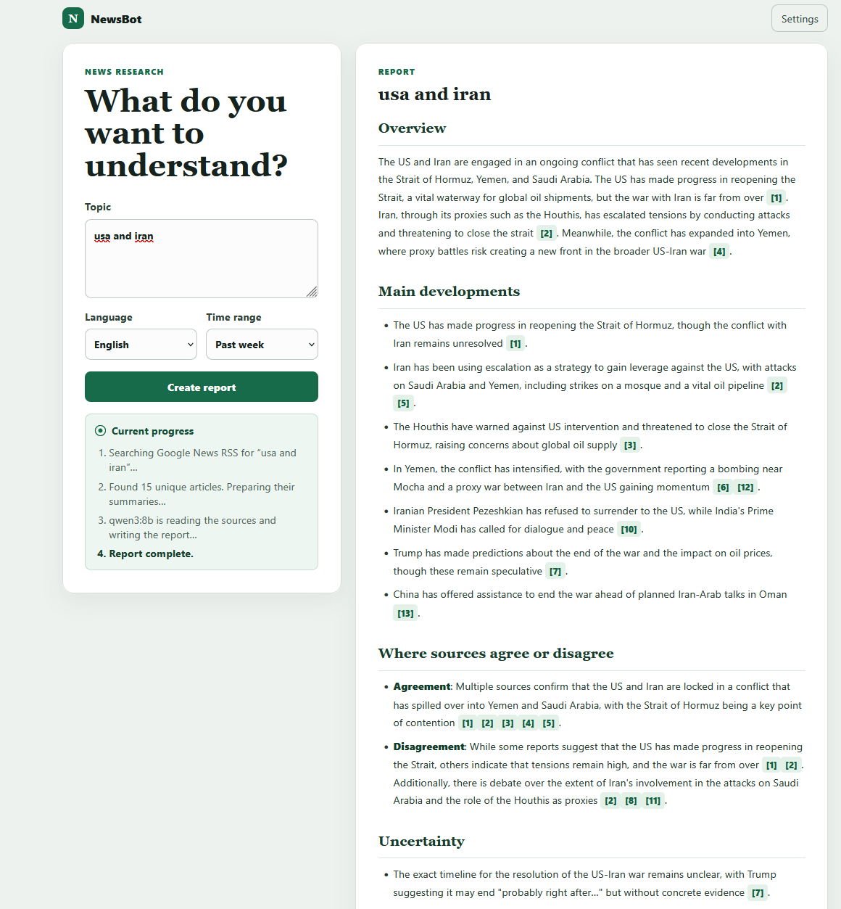

# NewsBot

NewsBot searches news and writes a short report with numbered sources. It
combines Google News RSS with optional NewsAPI results, then sends the headlines
and available summaries to a local Ollama model or an OpenAI-compatible API.



## Features

- English and German searches
- Duplicate removal by title and URL
- Progress updates during search and report generation
- Markdown reports with source links
- A settings screen for the model connection and API keys

## Run on Windows

```powershell
git clone https://github.com/SinaAc02/newsbot.git
cd newsbot
py -m venv .venv
.\.venv\Scripts\python.exe -m pip install -r requirements.txt
.\.venv\Scripts\python.exe -m uvicorn app.main:app --reload
```

Open [http://127.0.0.1:8000](http://127.0.0.1:8000) and complete the model setup.
For Ollama, start the service and install the model you enter in the settings.
For an API-hosted model, enter its base URL, model name and API key.

Google News RSS is available by default. Adding a NewsAPI key enables the
second search provider. Settings and keys are stored in the local `.env` file,
which is ignored by Git.

## Reports and sources

Each report uses up to 15 deduplicated results. The model receives their titles,
publishers, dates and summaries, with each summary limited to 500 characters.
Use the source links to read the articles and check important claims.

The time-range selector applies to NewsAPI requests. Google News RSS searches
use the topic and selected language. Report coverage depends on what those
providers return, and generated reports can contain mistakes.

## Tests

```powershell
.\.venv\Scripts\python.exe -m pip install -r requirements-dev.txt
.\.venv\Scripts\python.exe -m pytest
```

The tests cover settings storage, duplicate handling, report-prompt construction,
progress events and the setup requirement for research requests.
